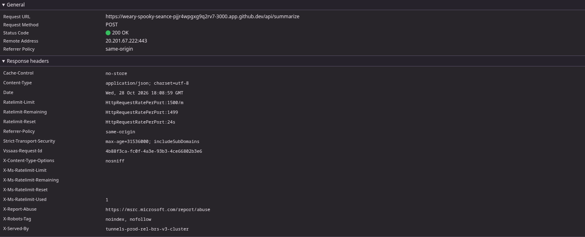

# Sintetiza Hub

Aplicação web para geração de resumos de textos utilizando inteligência artificial através da API Gemini.

## Funcionalidades

- Inserção de textos de até 10.000 caracteres.
- Geração de resumos em três níveis: curto, médio e detalhado.
- Escolha entre texto corrido e tópicos.
- Formatação automática do resultado.
- Opção para copiar o resumo gerado.
- Contador de caracteres.
- Controle de utilização para limitar solicitações à API.

## Tecnologias utilizadas

**Frontend**
- HTML5
- CSS3
- JavaScript (ES Modules)

**Backend**
- Node.js
- API Google Gemini

## Estrutura do projeto

```text
sintetiza-hub/
├── css/
│   └── styles.css
├── js/
│   ├── app.js
│   └── gemini.js
├── server/
│   └── gemini-service.js
├── docs/
│   ├── network-request.png
│   └── Proposta do app.pdf
├── index.html
├── server.js
├── config.example.js
└── .gitignore
```

O arquivo `data/usage.json` é criado automaticamente pelo servidor para armazenar os registros de utilização.

O arquivo `config.js` contém a chave de acesso à API e não deve ser enviado ao repositório.

## Configuração e execução

### 1. Requisitos

- Node.js 18 ou superior.
- Uma chave de API do Google Gemini.

### 2. Configurar a chave da API

Na raiz do projeto, copie o arquivo de exemplo:

```bash
cp config.example.js config.js
```

Abra o arquivo `config.js` e insira sua chave:

```javascript
module.exports = {
    GEMINI_API_KEY: "SUA_CHAVE_AQUI"
};
```

Nunca compartilhe ou envie sua chave de API ao GitHub.

### 3. Executar a aplicação

Inicie o servidor:

```bash
node server.js
```

A aplicação estará disponível em:

```text
http://localhost:3000
```

No GitHub Codespaces, acesse a aplicação pela porta 3000 na aba Ports.


## Evidência de funcionamento — Aba Rede

A captura abaixo demonstra uma solicitação realizada pelo navegador ao backend do Sintetiza Hub. A requisição utiliza o método POST para enviar o texto e as configurações do resumo, recebendo como resposta o resultado gerado pela aplicação.




## Controle de utilização

O servidor possui limites para reduzir o consumo indevido da API:

| Restrição | Limite |
|---|---:|
| Solicitações por IP | 15 por hora |
| Solicitações globais | 100 por dia |
| Tamanho máximo do texto | 10.000 caracteres |

Os limites podem ser ajustados diretamente no arquivo `server.js`.

Além disso, a utilização está sujeita às cotas e condições estabelecidas pelo Google Gemini.

## Uso de inteligência artificial

O projeto utiliza inteligência artificial em duas etapas:

**1. Funcionamento da aplicação**

A API Google Gemini é utilizada para analisar os textos enviados pelo usuário e gerar resumos personalizados, conforme o tamanho e o formato selecionados.

**2. Desenvolvimento do projeto**

O ChatGPT foi utilizado como ferramenta de apoio durante o desenvolvimento, auxiliando no planejamento da estrutura do projeto, implementação de funcionalidades, integração com a API Gemini, identificação de erros e melhorias no código.

As sugestões foram analisadas, adaptadas ao projeto e testadas no GitHub Codespaces. Foram realizados ajustes na interface, nas instruções de geração dos resumos, na apresentação do resultado e no controle de utilização da API.


## Plano B — Indisponibilidade da API

Caso o serviço Google Gemini esteja temporariamente indisponível, a aplicação utiliza uma resposta alternativa previamente armazenada no arquivo `server/fallback-summary.js`.

Essa resposta informa ao usuário que não foi possível processar o texto e orienta que tente novamente posteriormente.

O mecanismo é acionado automaticamente em situações como falhas de conexão, indisponibilidade do serviço e limites temporários da API.

A resposta alternativa é apenas uma mensagem de demonstração e não representa um resumo real do texto enviado.


## Segurança

- A chave da API é armazenada no backend.
- As solicitações ao Gemini são realizadas pelo servidor.
- Existe validação dos dados recebidos.
- O servidor controla a quantidade de solicitações.
- Arquivos de configuração com credenciais não devem ser versionados.

## Autor

**Wendel Costa**

GitHub: [@Wendel-Costa](https://github.com/Wendel-Costa)

---

Sintetiza Hub © 2026
